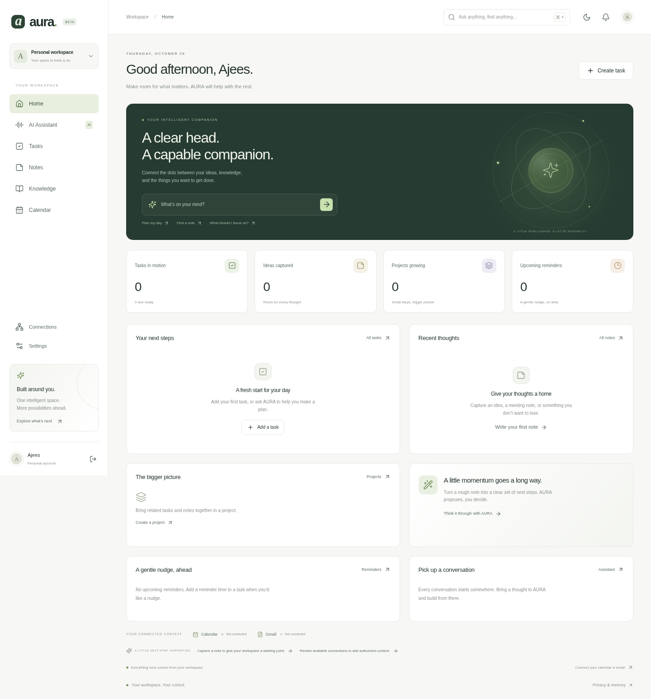

# AURA — Personal AI operating space for your PC

A working, desktop-first personal assistant foundation: one conversation can retrieve your notes and documents, inspect your tasks, propose changes, and execute individually approved actions. Your data is persisted in PostgreSQL. The UI is responsive, but this project runs on your PC; no APK or Android setup is needed.

This is independent TypeScript code. The existing `../jarvis` and `../aura-mobile` projects remain intact. No noncommercial JARVIS implementation was copied into this application.



## Start on Windows

1. Install **Node.js LTS, version 22 or newer**.
2. Download/extract this source folder. Double-click **Start AURA.cmd** inside `aura-desktop`.
3. Your browser opens at **http://127.0.0.1:3000** when the app is ready. Keep the terminal open. Create your own account; no sample account or invented workspace data is provided.
4. Notes, tasks, documents, projects, memory controls and reminders work without an AI key. For conversations, double-click **Configure AI.cmd**, or open a terminal in the same folder and run `npm run ai:configure`. Choose Gemini or OpenAI and paste your own key into the hidden prompt. Restart AURA afterward.

The first launch installs dependencies and initializes local PostgreSQL storage. The launcher runs the development server bound to loopback. It does not expose the app to the internet or install a Windows background service. Gemini may offer a free tier depending on your account, region, model and quota; no billing or API access is included with this source or a chat subscription.

## Developer quick start

```sh
npm ci
# Copy .env.example to .env.local (Windows: copy .env.example .env.local)
cp .env.example .env.local
npm run ai:configure       # optional; hidden provider-key prompt
npm run db:migrate
npm run dev
```

Production build, still local to the PC:

```sh
npm run typecheck
npm test
npm run build
npm start
```

`npm start` binds to `127.0.0.1`. To deploy a shared service, configure a standard PostgreSQL server, HTTPS, an appropriate reverse proxy and `AURA_APP_ORIGIN`; complete the operational work described below. Do not run multiple processes against the embedded database directory.

## Implemented capabilities

- **Accounts:** email/password signup and sign-in, salted scrypt passwords, hashed random sessions, expiry, sign-out, database-backed rate limiting, account deletion with password verification.
- **Central assistant:** persisted conversation history, real Gemini/OpenAI streamed text, typed tool selection, bounded multi-step planning, retrieval sources, tool status, durable approvals and audit records. Missing credentials return an actionable error; there is no pretend AI fallback.
- **Notes and projects:** create/edit/delete/search, tags, project grouping; find/summarize notes or extract proposed tasks through the configured assistant.
- **Tasks and reminders:** priorities, due dates, project grouping, completion, overdue/upcoming views, natural-language proposals through chat, and actual in-app notification delivery.
- **Controlled memory:** explicitly saved facts, preferences, goals and context; search/edit/delete; disable long-term retrieval and new saves. Conversation history is separate from saved memory.
- **Knowledge:** bounded PDF, UTF-8 TXT/Markdown and DOCX uploads; extraction, per-user chunks, PostgreSQL full-text retrieval and source references. Scanned PDFs need OCR before upload. Original uploaded binaries are not retained or served.
- **Dashboard:** real persisted tasks, reminders, notes, conversations, project progress and connection status. Empty accounts have useful empty states.
- **Google connectors:** OAuth/PKCE, encrypted credentials, refresh, scope review/revocation, Calendar and Gmail API adapters. Read-only scopes are the default. Write access is an explicit reconnect choice. Calendar mutations and Gmail draft/send calls still require individual action approval.
- **Voice:** browser speech recognition where supported, editable transcript, microphone permission/errors, stop controls and optional synthetic speech playback. Text always works. No actor voice cloning.
- **Extensibility:** a typed tool registry and versioned capability manifest, plus clearly marked roadmap pages for learning, shopping, travel, budgets, data, meetings, communication and a future plugin marketplace.

## Configuration

All secrets are server-side, in ignored `.env.local` or deployment secret storage. There is no API key input sent to the browser.

| Variable | Purpose |
| --- | --- |
| `DATABASE_URL` | Standard PostgreSQL connection string. Empty selects durable embedded PostgreSQL for one local server process. |
| `DATABASE_SSL` | Set `true` to require verified TLS in the `pg` driver; follow your database provider's connection requirements. |
| `AURA_DATA_DIR` | Embedded data directory; defaults to `.data/aura-db`. Back it up while AURA is stopped. |
| `AI_PROVIDER` | `gemini` (default, preserves existing provider choice) or `openai`. |
| `GEMINI_API_KEY`, `GEMINI_MODEL` | Gemini server credentials/model; default model `gemini-3.8-flash`, configurable. |
| `OPENAI_API_KEY`, `OPENAI_MODEL` | OpenAI server credentials/model; default `gpt-4.1-mini`. |
| `GOOGLE_CLIENT_ID`, `GOOGLE_CLIENT_SECRET` | Google Cloud **Web application** OAuth credentials. |
| `GOOGLE_REDIRECT_URI` | Exact registered callback; local default `http://127.0.0.1:3000/api/oauth/google/callback`. |
| `INTEGRATION_ENCRYPTION_KEY` | Base64-encoded 32-byte AES-GCM key. Keep stable and back it up separately. |
| `AURA_APP_ORIGIN` | Optional canonical HTTPS origin for reverse-proxied deployments; exact CSRF allowlist origin. |

Generate the connection encryption key locally:

```sh
node -e "console.log(require('crypto').randomBytes(32).toString('base64'))"
```

Enable Google Calendar API and Gmail API in your Google Cloud project, configure its consent screen, add yourself as a test user where required, and register the callback exactly. Open **Connections** in AURA to select scopes. Production Gmail scopes can require Google's verification or assessment; no approval is implied by this code. Without credentials or a connection, the app shows an honest configuration/connection error and never displays an invented inbox or calendar.

## Reminders and notification delivery

The built-in delivery channel is **in-app notifications**. With embedded PostgreSQL, reminders are processed by authenticated polling while the application is open, then persisted in the notification inbox. Your PC must be running AURA and the browser must remain open for this mode. Browser notifications additionally require browser permission and browser/platform support. There is no email, SMS or push delivery provider configured by default.

For PostgreSQL deployments, run a separate durable reminder worker:

```sh
npm run worker
```

The worker deliberately refuses embedded storage, since two independent processes must not share a PGlite directory. It writes real notification records and never labels an unavailable delivery channel as delivered.

## Data and trust boundaries

Every API derives identity from the server session. Repository queries are scoped by user ID; composite foreign keys prevent attaching another account's projects, documents or conversations. SQL is parameterized. Tests verify owner isolation across notes, tasks, projects, documents, memory and conversations. Current isolation is enforced by the application and constraints; **database row-level-security policies are not implemented**. Use a least-privilege database role for deployment.

Tools have validated inputs, output contracts, authorization metadata, confirmation policy, handlers and audit metadata. The model cannot run arbitrary code, shell commands or private network requests. Assistant writes require explicit proposals followed by user approval. The execution layer binds the approval to the owner, conversation, tool and immutable arguments; local writes are transactional, and approvals expire and cannot be replayed.

External API operations reserve an approval before network I/O. A crash or ambiguous network failure is never automatically retried, to avoid duplicate communications or events. Inspect the external provider before proposing another action. The UI displays only backend-confirmed outcomes.

Retrieved documents, notes, email and memory are untrusted reference data. Instructions inside them do not grant permission or bypass tool validation or review. Model-level prompt-injection resistance cannot be guaranteed; the execution boundary remains enforced. You must review recipients, dates and action contents carefully.

Turning memory off excludes saved-memory retrieval and prevents new saves; it does not erase prior conversations or data already sent to a configured AI provider. Delete memories/conversations or your account when appropriate. Account deletion cascades through application records; it is not remote deletion from the AI provider, Google, or existing backups. Disconnect Google services first when you also want remote token revocation.

## Important files

| Area | Files |
| --- | --- |
| UI and routes | `app/`, `components/`, `app/globals.css` |
| Database | `lib/db.ts`, `migrations/001_initial.sql`, `scripts/migrate.ts` |
| Accounts and request boundary | `lib/auth.ts`, `lib/http.ts` |
| Notes/tasks/memory/reminders | `lib/services/workspace.ts`, `scripts/reminders.ts` |
| Knowledge extraction/retrieval | `lib/services/knowledge.ts` |
| AI providers/tools/approvals | `lib/ai/` |
| Google OAuth/API adapters | `lib/connectors/google.ts` |
| Future capability contract | `lib/module-catalog.ts` |
| Windows launcher and AI setup | `Start AURA.cmd`, `scripts/launch.mjs`, `scripts/configure.mjs` |
| Tests and validation | `tests/`, `docs/VALIDATION.md` |

## Remaining work before a public startup launch

This is a working foundation, not a claim of production security certification. No real user provider credentials were supplied, and no live Gemini/OpenAI response, Google consent grant, email send or calendar mutation was performed during development. Automated provider tests use clearly isolated test transports.

Production milestones include verified email/recovery, abuse controls and quotas, stronger operational logging without sensitive content, retention/export policies, database backups and restore drills, least-privilege/RLS defense in depth, async document processing, optional pgvector embeddings, accessibility review, real-provider acceptance tests, Google app verification as applicable, and a signed desktop installer if desired. Voice availability varies by browser and some speech recognition engines process audio through their own service. File parsing currently occurs in-process with size/expansion bounds; isolate it in workers before accepting high-volume public uploads.

**Recommended next milestone:** run a small PC pilot with real provider keys and read-only Google connections, validate the complete note-to-approved-tasks workflow, then harden recovery, backups and deployment before introducing more super-app modules.

## Browser acceptance tests

These tests use actual authentication, APIs and PostgreSQL storage. They do not intercept production routes or invent AI responses. They verify an unconfigured provider error; actual orchestration with provider test transports is covered separately in the integration suite.

```sh
npx playwright install chromium
npm run test:e2e
```

The test runner starts its own loopback app on port 3100 using isolated `.data/e2e` storage. It creates test accounts and removes them after successful completion. `CHROME_EXECUTABLE_PATH` can select an already installed Chromium-compatible executable. CI is configured for Windows and Linux core checks and Linux browser acceptance tests.
