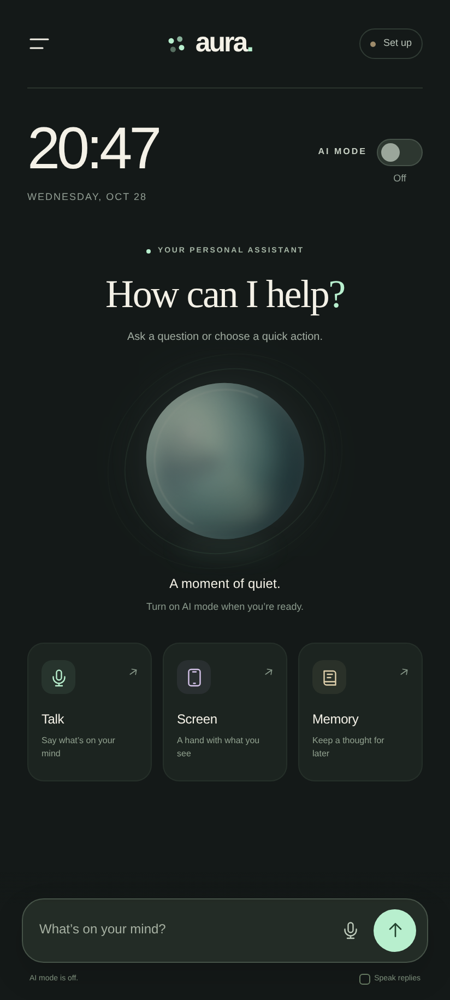
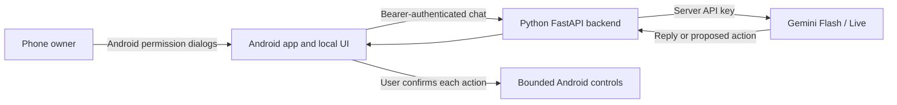

# AURA — Android personal AI companion

A first Android build based on your clock, AI-button, and side-menu sketch. AURA combines a native Android permission layer, a Python FastAPI backend, and a compact mobile interface. This is an application built on hosted foundation models; the repository does not train a new ChatGPT-scale model.



## Download

- [Android development APK](https://github.com/ajeesss154-ui/ajees/raw/refs/heads/main/aura-mobile/downloads/aura-android-debug.apk)
- [Source package](https://github.com/ajeesss154-ui/ajees/raw/refs/heads/main/aura-mobile/downloads/aura-source-1.0.zip)

The APK is a compiled development build for Android 8.0 and newer, with a recent Android System WebView. It requires your running backend for AI replies. Android may ask you to allow installation from your browser or file manager. Accessibility is optional and must be enabled manually by the phone owner; sideloaded apps may also require Android's restricted-settings step. Device manufacturers can impose further restrictions.

## Free-tier first

Start with a Google AI Studio project marked **Free tier** and your own Gemini API key. Google currently lists free-tier availability for the models below, with model/account eligibility and rate limits. Check the current [pricing](https://ai.google.dev/gemini-api/docs/pricing) and [rate limits](https://ai.google.dev/gemini-api/docs/rate-limits); this app does not activate billing or purchase API access.

| Purpose | Configurable default |
| --- | --- |
| Chat, reasoning, and selected screen-text assistance | `gemini-3.8-flash` |
| Natural live audio conversation | `gemini-3.8-live` |
| Dictation and reading replies | Android's installed speech and TTS services |

The Live voice path uses an original synthetic prebuilt voice. No movie audio, actor samples, or Tony Stark voice clone is included. The provider, model, and voice can evolve without rebuilding the phone permission layer. Optional OpenAI text-chat support is included for a later API account; Gemini is the initial default.

## What works in this version

- AI-mode switch, visible ongoing notification, and notification Stop action.
- Text chat, explicit microphone dictation, synthetic read-aloud, and opt-in live voice with interruption handling.
- Permission center showing Android's actual permission state. A refused permission does not count as granted.
- Explicit, one-shot screen **text** sharing through Android Accessibility. Screen content is not collected from accessibility events or sent continuously.
- Local saved notes, with creation/deletion controls. Notes are not automatically inserted into model conversations.
- Model-proposed app launches, ordinary web links, Home/Back, and limited scrolling. Every device proposal needs a separate native confirmation. A launch request is reported as requested rather than verified completion.
- Bounded Python API requests, authenticated phone connections, one-use voice tickets, and configurable request/session limits.

AI mode is not unrestricted access to the entire phone. This version does not capture screenshots or camera video, read all files/messages/contacts, perform arbitrary taps or typing, or run actions autonomously. Scrolling works only on a supported active application window; it can be unavailable when AURA is foreground. Android-protected screens remain subject to Android and app restrictions.

## Start the backend on your Windows PC

1. Extract the source package into a folder on your PC.
2. Double-click **Start AURA Server.cmd**.
3. When prompted, keep `gemini` and the default model. Paste your Gemini API key into the hidden terminal prompt.
4. The setup generates an **AURA access token**. Copy that token for the phone settings. The provider API key stays on the PC.
5. Keep the server terminal running. The starter binds port `8787` for local development. Both devices must be on the same trusted Wi-Fi, and Windows Firewall must allow the Python server on that private network.

Manual setup, from this project folder:

```powershell
py -3.12 -m venv .venv
& ".\.venv\Scripts\python.exe" -m pip install -r backend/requirements.txt
& ".\.venv\Scripts\python.exe" run.py --setup
& ".\.venv\Scripts\python.exe" run.py --host 0.0.0.0
```

The setup stores secrets in local `.aura.env`, which is excluded from Git. It never copies the API key into HTML, JavaScript, or the APK. Chat/live data goes through your backend to the selected provider. Free-tier provider data terms can differ from paid usage; review [Google's terms](https://ai.google.dev/gemini-api/terms) before sharing personal content.

## Connect the phone

1. Install/open the development APK. Open **Connection settings**.
2. Enter `http://YOUR_PC_PRIVATE_IP:8787` and the generated **AURA access token**. Use `ipconfig` on Windows to find the PC's local IPv4 address. `127.0.0.1` on your phone means the phone itself and will not reach your PC.
3. Tap **Save & connect**. Enable AI mode and allow its notification when Android asks. If activation was refused until permission is granted, tap AI mode again.
4. For voice, allow microphone access and choose **Talk → Dictate a message** or **Start live conversation**. Dictation text is reviewed before sending. Live voice sends microphone audio only for the explicit active session and stops when the app backgrounds or AI mode is turned off.

Development builds allow plain HTTP only for explicit loopback/private IPv4 targets. A local HTTP connection exposes its access token and content to that local network; use it only on a trusted development LAN. Production/release builds require HTTPS. For remote use, host the Python backend behind your own HTTPS reverse proxy, configure its address in the app, and keep provider credentials server-side. See [backend configuration](backend/README.md).

## Optional screen assistance

1. In the permission center, select **Screen assistance → Enable**. Read the disclosure and enable AURA's Accessibility service in Android Settings.
2. Turn on AI mode, open the app whose visible text you want to discuss, and select **Read screen** in AURA's notification.
3. Return to AURA within 60 seconds. Choose **Screen → Attach current screen**, review the text, add your question, and send.

The snapshot is consumed once and expires from native RAM after 60 seconds. It is also cleared when AI mode stops. Password/editable nodes and several sensitive app categories are excluded; app-name heuristics cannot identify every sensitive screen. You decide whether to send the displayed text. Some apps expose no readable text.

## Architecture



Phone actions execute locally only after native approval. The model cannot grant Android permissions. The app does not automatically buy service access or fall back to a paid provider.

## Build Android

Use Android Studio or JDK 17/21, SDK 35, and the included Gradle wrapper:

```powershell
cd android
.\gradlew.bat :app:testDebugUnitTest :app:assembleDebug
```

Canonical web assets are in `web/`. Keep `android/app/src/main/assets/` synchronized before a build; `tools/sync_assets.py` performs that copy. See [Android implementation notes](android/README.md). Local SDK paths, signing keys, caches, and build directories are excluded from source archives.

## Verification and current limits

Python API/voice tests, Kotlin URL-boundary tests, mobile-browser acceptance tests, and APK compilation are included in the validation record in [docs/VALIDATION.md](docs/VALIDATION.md). The provider and native-device flows still require testing with your own API key and Android phone. Successful compilation is not proof that every phone's speech service, permission UI, accessibility window, or live-model quota is available.

This new phone project is independent of the existing `jarvis/` desktop adaptation in the parent repository. AURA's original code is provided under the [MIT license](LICENSE); the desktop project's original source retains its separate license.
